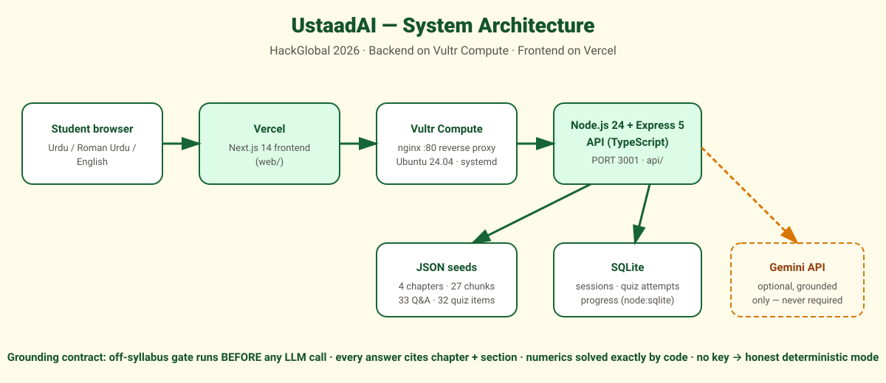
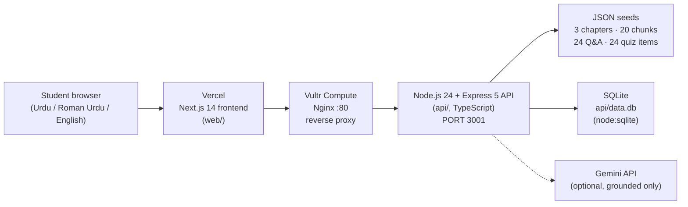

# UstaadAI v2 — System Diagram

## Architecture (text version)

Notes:

- The frontend is served by **Vercel**; the backend runs on a **Vultr Compute**
  instance (`vc2-1c-1gb`, Ubuntu 24.04, Los Angeles) behind **nginx**,
  managed by **systemd** (`ustaad-api.service`). This is a hard HackGlobal
  requirement — a Vercel/Render-only backend does not satisfy the brief.
- The API serves `GET /health`, `GET /api/chapters`, `POST /api/tutor/chat`,
  `POST /api/quiz/start`, `POST /api/quiz/submit`, and
  `GET /api/progress/:sessionId`.
- Retrieval is deterministic keyword scoring over the JSON seeds.
  SQLite stores sessions, quiz attempts, and progress.

## The grounding contract

Every tutor answer obeys these five rules, in this order:

1. **Off-syllabus gate runs BEFORE any LLM call.** If the question is outside
   the seeded syllabus, it is politely refused and redirected — no LLM is
   consulted, nothing is hallucinated.
2. **Every answer cites chapter + section chunk ids.** No citation, no answer.
   Citations name the exact chunk the answer came from.
3. **Numerics are solved exactly, never by LLM.** Physics numerics
   (`vf = vi + at`, `S = vi·t + ½at²`, free fall `g = 10`) are computed by code.
   The LLM never does the arithmetic.
4. **No key → deterministic mode, labelled honestly.** Without
   `GEMINI_API_KEY`, the API runs in deterministic mode and says so.
   It never pretends to be an LLM.
5. **Gemini sees only retrieved chunks; failure falls back to deterministic.**
   In Gemini mode the model receives only the chunks retrieved for that
   question. If the Gemini call fails, the API falls back to the deterministic
   answer instead of failing or inventing one.
